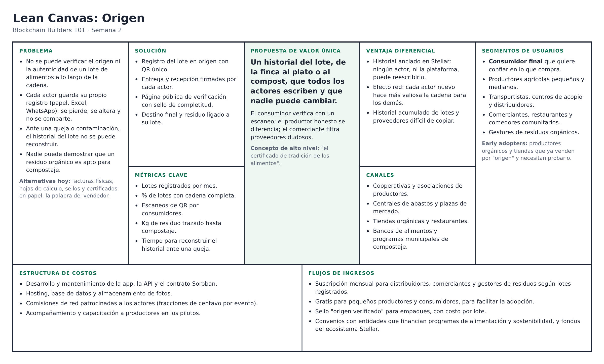
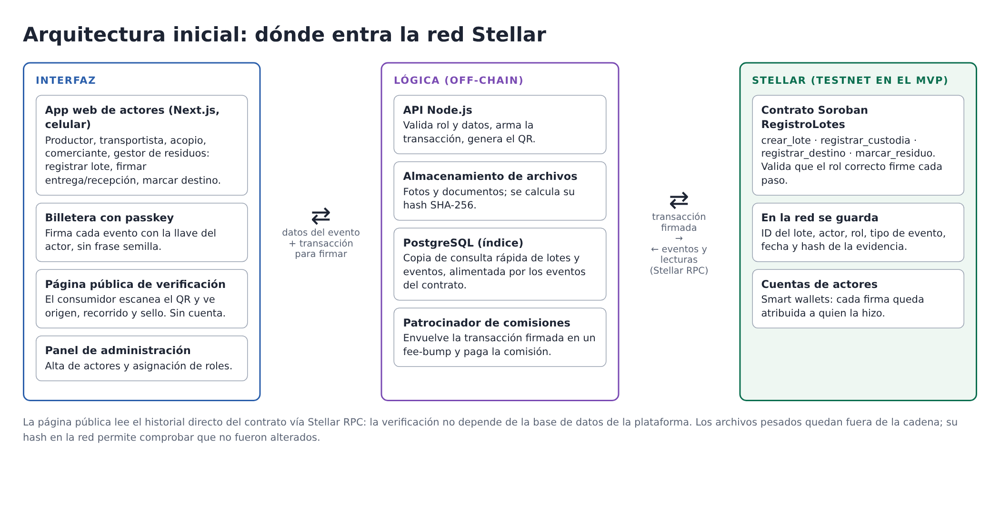

# Product Blueprint

**Nombre del proyecto:** Origen

**Repositorio (enlace obligatorio):** [bootcamp-stellar](https://github.com/burbinagomez/bootcamp-stellar)

---

## Contenido

1. Priorización de historias
2. Propuesta de valor
3. Flujo de usuario
4. Alcance del MVP
5. Lean Canvas
6. Backlog priorizado (Kanban)
7. Arquitectura inicial
8. Uso de Stellar y justificación

---

## 1. Priorización de historias

**Criterio de priorización:** MoSCoW aplicado sobre las 21 historias de usuario. Una historia es **imprescindible** si sin ella no existe un historial verificable del lote (origen, custodia y consulta). Es **debería** si le da al usuario una razón directa para adoptar la plataforma o cubre la parte de residuos y excedentes del problema. Las historias que dependen de tener meses de datos o de actores que no están en el primer piloto quedan fuera. Fusioné las historias que se repetían.

| Prioridad | Historia | Por qué entra al backlog |
| :---: | --- | --- |
| 1 | Como productor agrícola quiero registrar cada lote al momento de la cosecha y obtener un código único, para demostrar de dónde viene mi producto. | Imprescindible: es el primer eslabón y todo lo demás se apoya en él. |
| 2 | Como administrador quiero asignar a cada usuario su rol, para que cada actor solo registre los eventos que le corresponden. | Imprescindible: sin roles el historial pierde credibilidad. |
| 3 | Como transportista, centro de acopio o distribuidor quiero firmar la entrega y la recepción de un lote, para que la cadena de custodia quede registrada y no pueda modificarse. | Imprescindible: ataca la fricción principal del Problem Brief (pasos 2 y 4). |
| 4 | Como consumidor final quiero escanear el QR del producto y ver su origen y recorrido, para saber si es auténtico antes de pagar. | Imprescindible: es el valor visible para el usuario principal. |
| 5 | Como comerciante quiero ver un sello que indique si el historial del lote está completo o tiene saltos, para decidir rápido si lo compro. | Debería: convierte el historial en una decisión simple y ayuda a la adopción. |
| 6 | Como restaurante o servicio de alimentos quiero marcar el destino de cada excedente (donado, vendido o compostaje), para demostrar que no termina en la basura. | Debería: cubre los excedentes y el desperdicio, que son parte del problema elegido. |
| 7 | Como gestor de residuos orgánicos quiero registrar los residuos recibidos ligados a su lote de origen y marcarlos como aptos o no aptos para compostaje, para garantizar abono de material limpio. | Debería: cierra el ciclo del residuo orgánico. |

---

## 2. Propuesta de valor

**Usuario (del Problem Brief):** La persona que compra alimentos o productos agrícolas y quiere confiar en que lo que recibe es auténtico, junto con los actores que lo mueven: productor, transportista, distribuidor, comerciante y gestor de residuos orgánicos.

**Resultado que obtiene:** Con un escaneo, el consumidor ve de qué finca viene el lote, cuándo se cosechó y por qué manos pasó antes de llegar al estante. Cada actor de la cadena obtiene evidencia firmada de lo que entregó y recibió, y el gestor de residuos puede demostrar que el material que convierte en abono viene de un origen limpio.

**Por qué elegiría esta solución:** Porque deja de depender de la palabra del vendedor. El productor honesto puede diferenciar su producto, el comerciante puede filtrar proveedores dudosos y, cuando aparece una queja o contaminación, el historial completo del lote se reconstruye en minutos, sin perseguir papeles ni mensajes de WhatsApp.

**En qué se diferencia de cómo lo resuelve hoy:** Hoy la información queda repartida en facturas, hojas de cálculo y chats que cada actor guarda a su manera, que se pierden o se pueden alterar, y que nadie más puede revisar. En esta solución todos los actores escriben sobre un mismo historial que ninguno controla por sí solo y que nadie puede editar después. La confianza deja de estar en un intermediario y pasa a estar en un registro compartido y verificable.

---

## 3. Flujo de usuario

| Paso | Rol | Qué hace | Punto de interacción |
| :---: | :---: | --- | --- |
| 1 | Administrador | Da de alta a cada actor y le asigna su rol; la plataforma le crea una billetera con passkey, sin frases semilla. | Panel web de administración |
| 2 | Productor | Registra el lote al cosechar (producto, finca, fecha, cantidad, foto) y firma el registro. | App web en el celular + billetera |
| 3 | Plataforma | Guarda la foto fuera de la cadena, ancla su huella (hash) en la red y genera el QR del lote. | Backend + contrato en Stellar |
| 4 | Transportista / acopio | Escanea el QR al recoger y firma "entregado" con el productor; al llegar al acopio, el receptor firma "recibido" y anota el estado. | App web + billetera |
| 5 | Distribuidor / comerciante | Antes de aceptar el lote revisa el historial y el sello de completitud, y firma la recepción. | App web |
| 6 | Consumidor | Escanea el QR del empaque y ve origen, recorrido y sello sin crear cuenta. | Página pública de verificación |
| 7 | Comerciante o restaurante | Marca el destino de lo que sobra: vendido, donado o enviado a compostaje. | App web + billetera |
| 8 | Gestor de residuos | Recibe el residuo ligado a su lote de origen y lo marca como apto o no apto para compostaje. | App web + billetera |

Cada firma de los pasos 2, 4, 5, 7 y 8 es una transacción en Stellar: queda con fecha, autor y rol, y no se puede editar. Si un actor se salta su paso, el lote muestra un salto en la cadena y el sello pasa de "completo" a "incompleto", tanto para el comerciante como para el consumidor. La página pública (paso 6) solo lee información, así que el consumidor no necesita billetera ni conocer nada de blockchain.

---

## 4. Alcance del MVP

| Dentro del MVP (funcionalidad central) | Fuera del MVP (deseable, para después) |
| --- | --- |
| Registro de actores con rol asignado por el administrador | Validación del productor por cooperativas o asociaciones externas |
| Registro del lote en origen con foto y QR único | Sensores IoT de temperatura y GPS durante el transporte |
| Entrega y recepción firmadas entre actores (cadena de custodia) | Reportes de consumidores sobre productos sospechosos |
| Página pública de verificación por QR con sello de completitud | Panel de métricas para productores (escaneos y tiendas) |
| Registro del destino final: vendido, donado o compostaje | Certificados de compostaje y de donación para reportes de sostenibilidad |
| Registro del residuo ligado a su lote y marcado apto/no apto | Reportes mensuales para entidades que financian programas de alimentación |
| Despliegue en Stellar testnet | Incentivos con tokens y despliegue en mainnet |

**Por qué el recorte sigue entregando valor:** El MVP cubre de punta a punta el recorrido de un lote, desde la finca hasta el consumidor o el compostaje, que es exactamente la fricción priorizada en el Problem Brief: la falta de una trazabilidad compartida y verificable. Con solo estas funciones ya es posible probar la hipótesis central con un piloto pequeño (un productor, un acopio y una tienda): que los actores registran sus eventos y que el consumidor confía más en un producto con historial completo. Lo que queda fuera son mejoras de confianza (validación externa, sensores), incentivos de adopción o reportes que solo tienen sentido con meses de datos. Ninguna de esas piezas es necesaria para demostrar que el historial compartido funciona, y todas se pueden construir encima del mismo contrato sin rehacerlo.

---

## 5. Lean Canvas

**Enlace al Lean Canvas (obligatorio):** [Lean Canvas del proyecto](https://github.com/burbinagomez/bootcamp-stellar/blob/main/docs/semana2/img/lean-canvas.png)

---

## 6. Backlog priorizado (Kanban)

**Enlace al tablero (obligatorio):** [Tablero Kanban en GitHub Projects](https://github.com/users/1PcodeP1/projects/1)

El tablero tiene las 7 historias priorizadas en la sección 1, en las columnas **Todo / In Progress / Done**, y cada tarjeta incluye sus criterios de aceptación.

---

## 7. Arquitectura inicial

**Diagrama (imagen o enlace):**

| Capa | Componente | Qué hace |
| :---: | --- | --- |
| Interfaz | App web responsive (Next.js) para actores + página pública de verificación | Los actores registran lotes y firman eventos desde el celular; el consumidor consulta el QR sin crear cuenta. |
| Lógica | API en Node.js + base de datos (PostgreSQL) + almacenamiento de archivos | Valida roles y datos, guarda fotos y documentos fuera de la cadena, calcula su hash, genera los QR, arma las transacciones y lleva un índice de lotes para que las búsquedas sean rápidas. |
| Stellar | Contrato Soroban `RegistroLotes` + cuentas de los actores + patrocinio de comisiones | El contrato guarda el lote, cada evento firmado (actor, rol, fecha y hash de la evidencia) y valida que solo el rol correcto registre cada paso. |

**En qué punto entra la red:** La red entra cada vez que un actor firma algo: el registro del lote en origen, cada entrega y recepción, el destino final y el marcado del residuo. La app arma la transacción, el actor la firma con su billetera (passkey en el celular) y la plataforma paga la comisión mediante patrocinio, así el productor no necesita tener XLM. En la red solo van datos pequeños y verificables: identificadores, rol, fecha y el hash de la foto o del documento. Los archivos pesados quedan fuera de la cadena y cualquiera puede comprobar que no fueron cambiados comparando su hash. La página pública lee el historial directamente del contrato a través de Stellar RPC, de modo que la verificación no depende de que la base de datos de la plataforma diga la verdad. Si la base de datos se cae o se altera, el historial sigue disponible y verificable en la red.

---

## 8. Uso de Stellar y justificación

**Criterio de pertinencia (del Problem Brief):** Varias partes que no confían entre sí (productor, transportista, distribuidor, comerciante, consumidor y gestor de residuos) necesitan compartir un mismo registro, y el histórico de cada lote no puede alterarse.

| Componente de Stellar | Para qué lo uso | Por qué ese y no otra alternativa |
| --- | --- | --- |
| Contratos inteligentes Soroban | Guardar cada lote y sus eventos, y aplicar las reglas: quién puede registrar qué paso y en qué orden. | Las reglas quedan en la red y no en el servidor de un actor, que podría cambiarlas. Una base de datos central volvería a poner la confianza en un solo operador. |
| Cuentas de Stellar con firma (smart wallets con passkeys) | Que cada actor firme sus eventos con su propia llave, desde el celular y sin frases semilla. | La firma demuestra quién registró cada paso y nadie puede firmar por otro. Las passkeys bajan la barrera para productores sin experiencia en cripto. |
| Patrocinio de comisiones (fee-bump transactions) | Que la plataforma pague las comisiones de las transacciones de los actores. | El productor o el comedor no tienen que comprar XLM. Las comisiones de Stellar son de fracciones de centavo, lo que hace viable registrar muchos eventos pequeños. |
| Stellar RPC y eventos del contrato | Leer el historial del lote para la página pública y mantener actualizado el índice de la API. | Permite que cualquier persona verifique el historial directo en la red, sin confiar en la base de datos de la plataforma. |

Para el MVP uso testnet. Más adelante se podría emitir un activo de Stellar como incentivo para quienes registren cadenas completas, pero queda fuera del alcance actual.
