# Documentación – Semana 3

## Front construido

Esta semana se construyó el front de Origen en la carpeta `frontend/`, con Next.js 16 (App Router), React 19, Tailwind CSS 4 y la librería `motion` para las animaciones. La meta fue que se pudiera recorrer de punta a punta el flujo de usuario de la sección 3 del Product Blueprint, con datos de prueba y firmas simuladas, de forma que en la semana 4 solo haya que cambiar la capa de Stellar y no las pantallas.

La versión desplegada está en https://origen-two-sigma.vercel.app (Vercel, con `frontend/` como carpeta raíz).

### Pantallas y su lugar en el flujo

| Ruta | Rol | Paso del Blueprint | Qué hace |
| --- | --- | --- | --- |
| `/` | Cualquier actor (productor en la demo) | 1. Billetera con passkey | Ingreso con passkey simulada. Muestra la red (Stellar testnet) y avisa que las firmas son simuladas. |
| `/productor` | Productor | 2. Registro del lote | Lista de lotes con la insignia del sello (Completo, En tránsito o Con salto) y un resumen: lotes del mes, cadenas completas y lotes en tránsito. |
| `/productor/nuevo` | Productor | 2. Registro del lote | Registra el lote (producto, kg, fecha de cosecha, finca y foto opcional) y lo firma. La huella SHA-256 de la foto se calcula en el navegador. |
| `/lotes/[id]/qr` | Productor / Plataforma | 3. QR del lote | Genera un QR real que apunta a `/v/[id]`, permite compartir el enlace e imprimir la etiqueta. |
| `/custodia/[id]` | Transportista y Acopio | 4. Cadena de custodia | Doble firma de cada entrega (quien entrega y quien recibe) y estado del lote al recibir. Cubre los tramos finca → transportista y transportista → acopio. |
| `/recepcion/[id]` | Comerciante | 5. Revisión y recepción | Muestra el sello (completo o con salto) y el recorrido firmado. El comerciante firma la recepción o rechaza el lote. |
| `/v/[id]` | Consumidor (sin cuenta) | 6. Verificación pública | Página pública con origen, recorrido, sello y la lista de firmas. |
| `/destino/[id]` | Comerciante / restaurante | 7. Destino del sobrante | Registra si lo que sobró fue vendido, donado o enviado a compostaje, con los kg y quién lo recibe. |
| `/residuo/[id]` | Gestor de residuos | 8. Residuo | Marca el residuo como apto o no apto para compostaje y cierra el ciclo del lote. |
| `/admin` | Administrador | 1. Alta de actores | Panel de escritorio con actores, roles y estado de la billetera (activa o pendiente de passkey), indicadores, lotes, saltos, comisiones patrocinadas y el botón "Restablecer datos de prueba". |

Con estas pantallas quedan cubiertas seis de las siete funciones que la sección 4 del Blueprint pone dentro del MVP: registro de actores con rol (`/admin`, que además permite dar de alta un actor nuevo), registro del lote con foto y QR único (`/productor/nuevo` y `/lotes/[id]/qr`), entrega y recepción firmadas (`/custodia/[id]` y `/recepcion/[id]`), página pública con sello de completitud (`/v/[id]`), destino final del sobrante (`/destino/[id]`) y residuo marcado apto o no apto (`/residuo/[id]`). La séptima, el despliegue en Stellar testnet, es el trabajo de la semana 4. Cada pantalla enlaza con la siguiente, así que en una demo se puede seguir un mismo lote desde la cosecha hasta la compostera sin escribir direcciones a mano. Si se abre un lote que no existe, la app muestra una pantalla de "lote no encontrado" en vez de fallar.

### Capturas

**Ingreso y lotes del productor (pasos 1 y 2).**

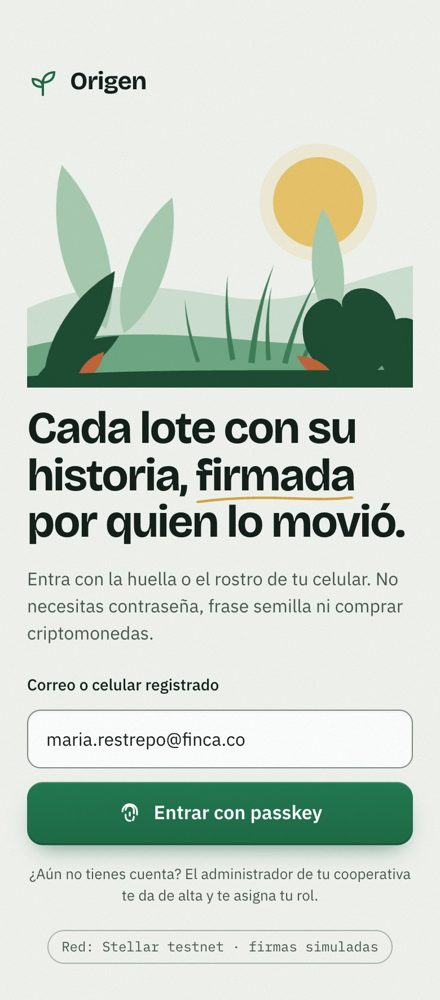
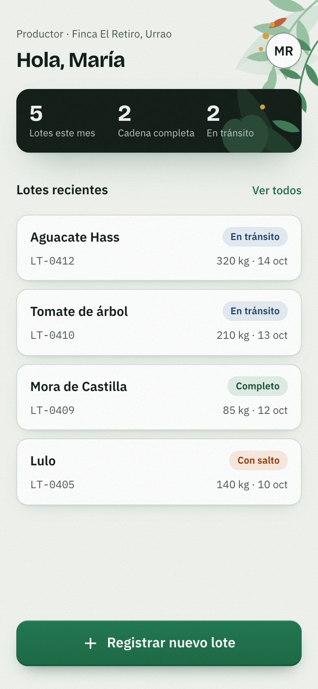
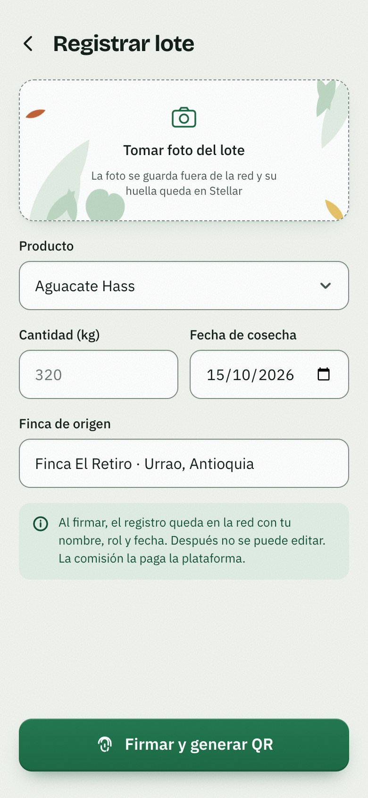

**QR y cadena de custodia (pasos 3 y 4).**

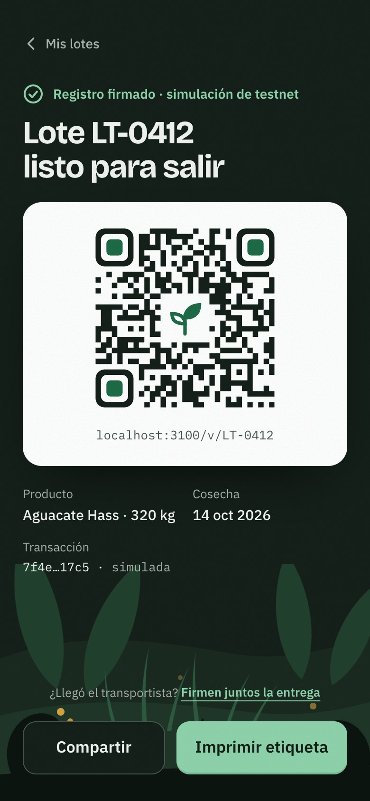
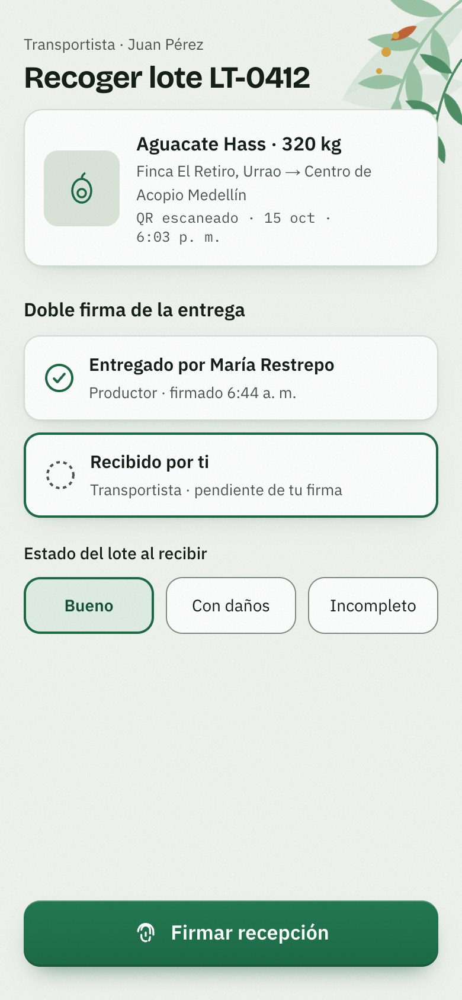
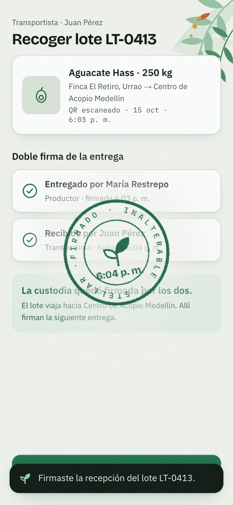

**Recepción en tienda (paso 5), con historial completo y con salto.**

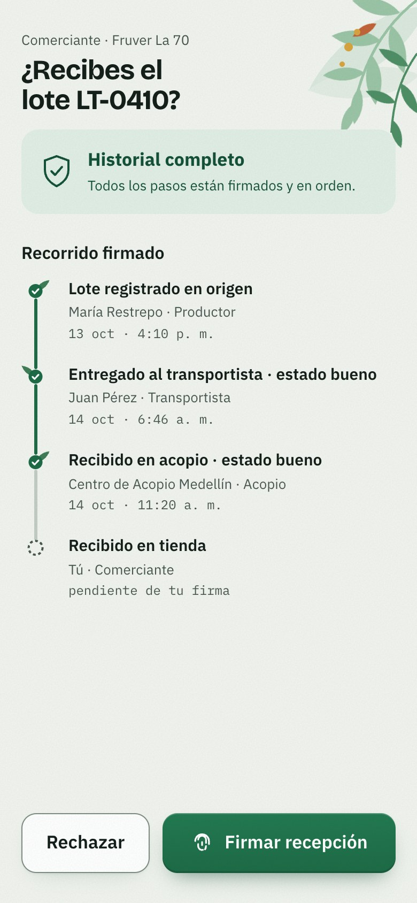
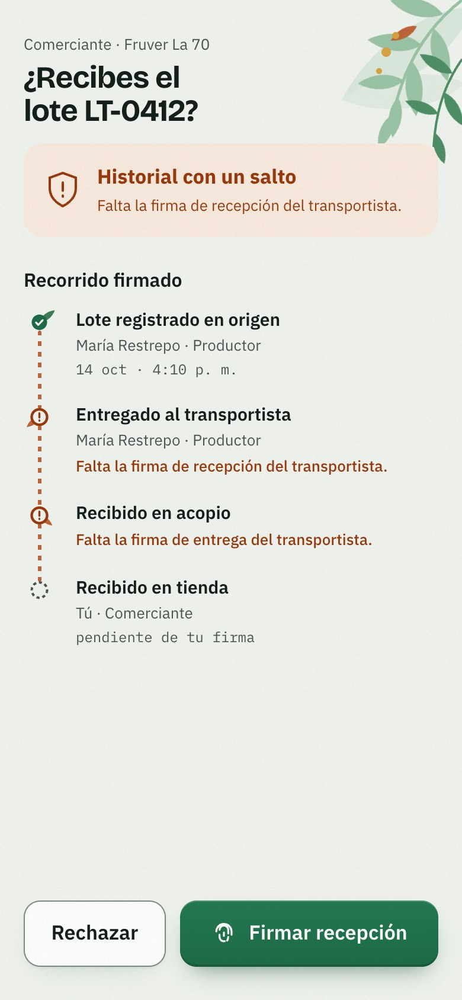

**Verificación pública (paso 6), con historial completo y con salto.**

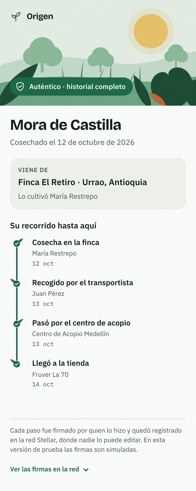
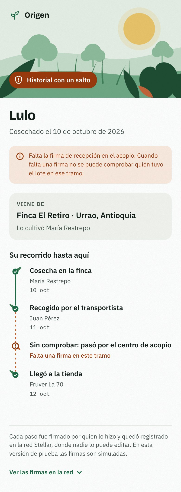

**Destino del sobrante y residuo (pasos 7 y 8).**

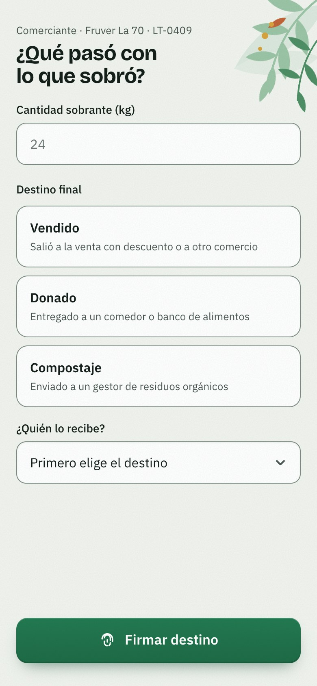
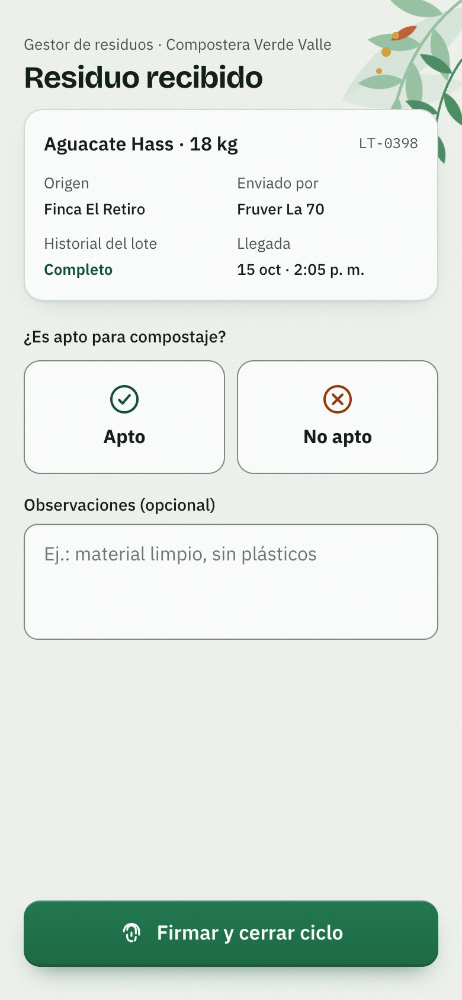
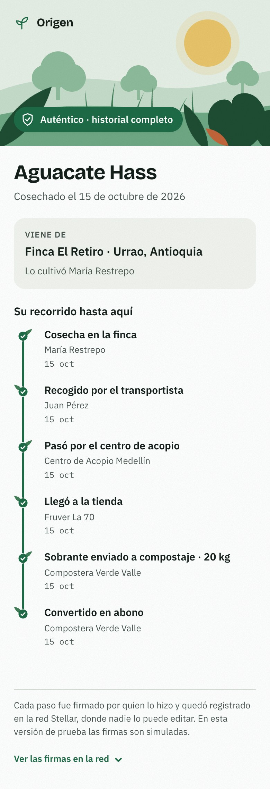

**Panel de administración (paso 1) y lote inexistente.**

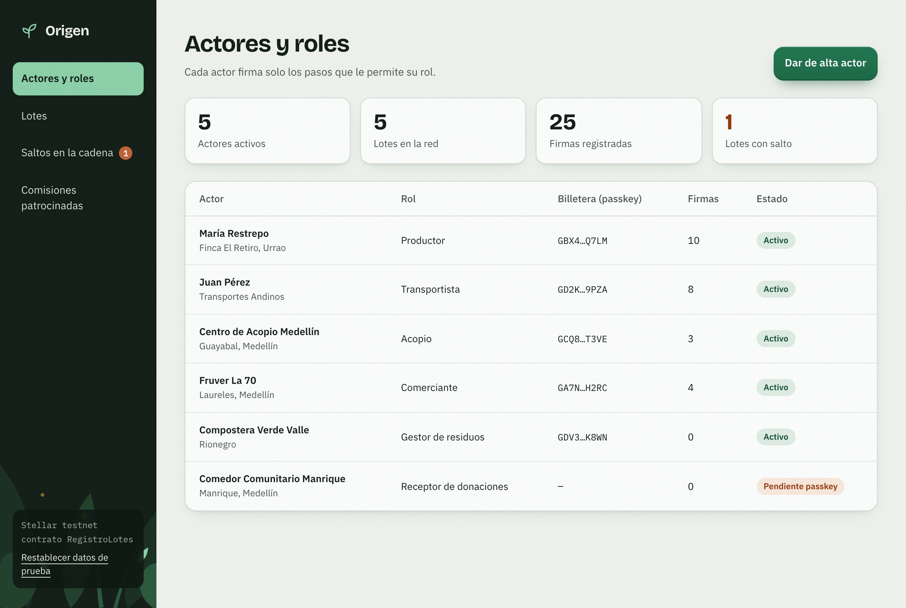
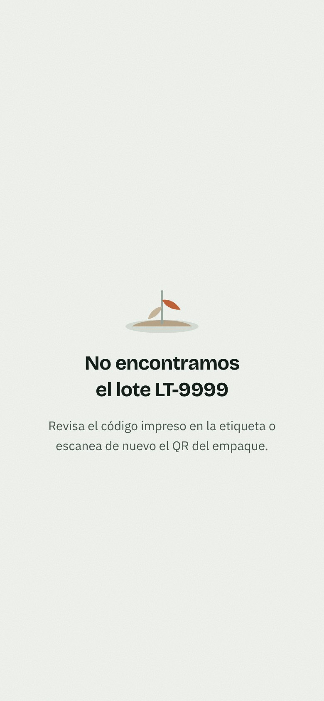

### Cómo funciona por dentro

**Datos de prueba.** `frontend/src/data/actores.ts` define seis actores: la productora, el transportista, el centro de acopio, la tienda, la compostera y un comedor que todavía no activa su passkey. `frontend/src/data/lotes.ts` trae cinco lotes, de LT-0398 a LT-0412, cada uno en un estado distinto: LT-0398 llegó a la tienda y su sobrante va a compostaje; LT-0405 tiene un salto porque el acopio nunca firmó la recepción; LT-0409 está completo hasta la tienda; LT-0410 espera a la tienda; y LT-0412 tiene la entrega a medio firmar. Así cada pantalla tiene un caso real para mostrar.

**Estado en el cliente.** `frontend/src/lib/store.tsx` es un contexto de React que guarda lotes, eventos y actores en el estado y los persiste en `localStorage`. Por eso un lote nuevo solo existe en el navegador donde se creó: si se escanea su QR desde otro celular, no aparece. Es un atajo consciente para esta semana. En la semana 4 esas lecturas pasan a hacerse contra el contrato por Stellar RPC.

**El sello.** `frontend/src/lib/sello.ts` calcula el sello a partir de los eventos firmados de un lote. Las etapas van en orden: origen → transporte → acopio → tienda → destino → residuo. Las entregas entre actores necesitan dos firmas, la de quien entrega y la de quien recibe. Una etapa es un salto en tres casos: si está incompleta y una etapa posterior ya tiene firmas; si el actor que va a firmar exige que todo lo anterior esté firmado (parámetro `hasta`, que usa la recepción en tienda); o si sus firmas están fuera de orden cronológico. El lote es "completo" cuando no tiene saltos y ya llegó a la tienda; si no tiene saltos pero aún no llega, queda "en tránsito". La etapa de residuo solo cuenta cuando el destino del sobrante es compostaje. Esta lógica tiene 6 pruebas en `sello.test.mjs`, que corren con `npm test`.

**La firma.** `frontend/src/lib/stellar/` concentra todo lo que en la semana 4 hablará con la red. `firmarEvento` recibe el evento, espera un momento y devuelve un hash de transacción aleatorio con la fecha. `conectarPasskey` simula el ingreso con la billetera. `urlTransaccion` arma el enlace al explorador o devuelve `null` mientras las firmas sean simuladas. La configuración sale de variables `NEXT_PUBLIC_*` (red, RPC, passphrase, id del contrato y explorador) y apunta a testnet por defecto. La bandera `simulada` vale `true` mientras no haya id de contrato, y las pantallas la usan para avisar que las firmas son de prueba. Como ninguna pantalla llama a Stellar directamente, cambiar estos mocks por llamadas reales a Soroban no obliga a tocar la interfaz.

**Cómo probarlo.** Desde `frontend/`, `npm install` y `npm run dev` levantan la app, y `npm test` corre las pruebas del sello. Los lotes de prueba sirven de atajo para cada paso: `/custodia/LT-0412` para firmar la recepción del transportista, `/recepcion/LT-0410` para recibir en la tienda un lote completo, `/recepcion/LT-0405` o `/v/LT-0405` para ver un salto, `/destino/LT-0409` para registrar un sobrante y `/residuo/LT-0398` para cerrar el ciclo en la compostera. Si algo queda en un estado raro, "Restablecer datos de prueba" en `/admin` devuelve todo al inicio.

### Decisiones visuales

Se mantuvo la identidad del diseño: paleta de verdes, ocre y terracota; Bricolage Grotesque para títulos, IBM Plex Sans para el texto e IBM Plex Mono para hashes e identificadores; siluetas de plantas en capas; una columna móvil de 430 px (mobile first) y el panel de administración en formato de escritorio.

Sobre esa base se agregaron detalles que refuerzan la idea de una cadena firmada:

- **Tallo de custodia.** La línea de tiempo es un tallo que crece. Cada paso firmado brota una hoja, un paso pendiente es un capullo punteado y un salto corta el tallo en terracota y deja una hoja marchita.
- **Sello de tinta.** Al firmar cae un sello verde con el texto "FIRMADO · INALTERABLE · STELLAR" y la hora de la firma.
- **Movimiento.** Subrayado a mano en ocre bajo la palabra "firmada" en el ingreso, parallax en las capas de plantas, entrada escalonada de los elementos, hojas que se mecen, una rama que crece en las pantallas de actores y luciérnagas que titilan en las escenas oscuras.
- **Textura y relieve.** Grano de papel sutil, sombras con tinte verde y botones con relieve.
- **QR.** Se revela en bandas diagonales, con el centro de los buscadores en verde y un brote como emblema. Usa corrección de errores nivel H y se verificó que se puede leer con el emblema puesto.
- **Navegación y estados.** Transiciones entre rutas que indican si se va hacia adelante o hacia atrás (React View Transitions), tarjetas de opción cuyo marcador de selección se desliza de una a otra, esqueletos de carga con forma de hoja, estados vacíos con un brote y una planta marchita para los errores.

En accesibilidad: contraste AA en toda la app (la revisión con axe encontró 0 violaciones), bordes de controles más fuertes (#7F8C83, contraste 3:1), anillo de foco visible, etiqueta en cada campo, botones e inputs de radio reales, áreas táctiles de al menos 44 px y respeto a `prefers-reduced-motion`. En destino y residuo ninguna opción viene marcada por defecto: como la firma no se puede editar después, el actor tiene que elegir de forma explícita.

## Decisión técnica

**Opción elegida: A, contrato propio.** Origen usará un contrato Soroban propio, `RegistroLotes`, tal como se definió en la sección 8 del Product Blueprint.

**Qué hará el contrato.**

- Registrar cada lote y cada evento firmado con actor, rol, fecha y hash de la evidencia, por ejemplo la huella SHA-256 de la foto que el front ya calcula.
- Validar que solo el rol correcto firme cada paso y en el orden de la cadena: el productor registra y entrega, el transportista recibe y entrega, el acopio recibe, el comerciante recibe y marca el destino, y el gestor de residuos marca el residuo.
- Exponer el historial de cada lote para que la página pública `/v/[id]` lo lea por Stellar RPC, sin depender de la base de datos de la plataforma.

**Por qué hace falta un contrato propio.** Las reglas de Origen son del producto y no genéricas: quién puede firmar cada paso, que una entrega necesite la firma de los dos actores y que no se pueda saltar un tramo sin que se note. Ninguna herramienta existente del ecosistema aplica esas reglas de rol y de orden de custodia. Si no viven en la red, vuelven a quedar en el servidor de un solo operador, que es justo lo que el Blueprint busca evitar.

**Opción descartada: B, servicio de anclaje o registro de hashes.** Un servicio que solo ancla hashes en la red prueba que un dato no cambió, pero no controla quién firma qué. Cualquiera con acceso podría anclar un evento de un rol que no le corresponde, y la validación tendría que hacerla el backend. Con eso la confianza vuelve al backend y se pierde la razón principal para usar Stellar.

**Piezas del ecosistema que lo complementan.**

- Billeteras inteligentes (smart wallets) con passkeys, para que cada actor firme desde el celular sin frases semilla.
- Patrocinio de comisiones con transacciones fee-bump, para que la plataforma pague y el productor no tenga que comprar XLM.

**Alcance actual.** Todo el trabajo es en testnet. El contrato `RegistroLotes` no se escribió esta semana: el front ya tiene el punto de conexión en `src/lib/stellar/` y la variable para el id del contrato, pero las firmas siguen simuladas. Escribirlo y desplegarlo es el trabajo de la semana 4.

## Participación del equipo

| Integrante | Usuario de GitHub | Aporte en este entregable |
| --- | --- | --- |
| Carlos Baena | 1PcodeP1 | Diseño de pantallas, construcción completa del front, documentación y README. |
| Brayan Urbina | burbinagomez | No participó en este entregable. |
| Joann Cruz | JoannC19 | No participó en este entregable. |

Este entregable lo completó un solo integrante, por eso los commits de esta semana son de una sola persona.

## Bloqueos y siguiente paso

**Pendiente**

- Firmas reales en Stellar testnet; hoy son simuladas.
- Persistencia fuera del navegador; hoy los datos viven en `localStorage`.
- Que el comerciante pueda rechazar un lote dejando un registro en la red. Hoy el botón "Rechazar" solo muestra un aviso.

**Siguiente paso (semana 4)**

- Escribir y desplegar el contrato `RegistroLotes` en testnet.
- Conectar las billeteras con passkey y el patrocinio de comisiones.
- Cambiar los mocks de `src/lib/stellar/` por llamadas reales.

**Bloqueo**

- La participación del equipo: esta semana el trabajo lo hizo un solo integrante, así que las tareas avanzan una tras otra y no en paralelo.
